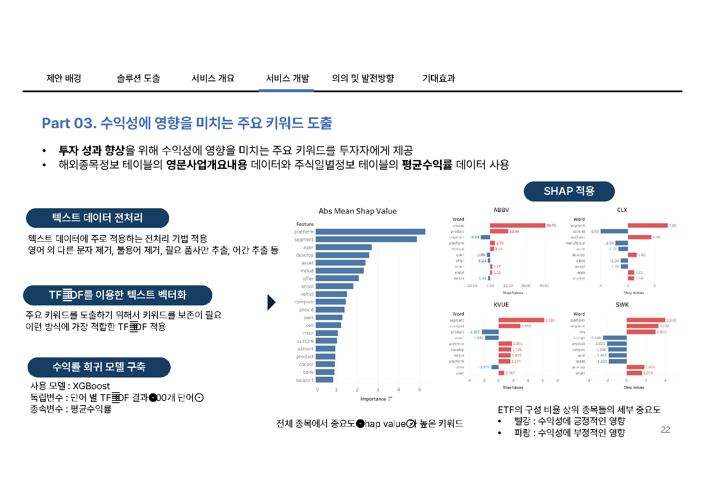
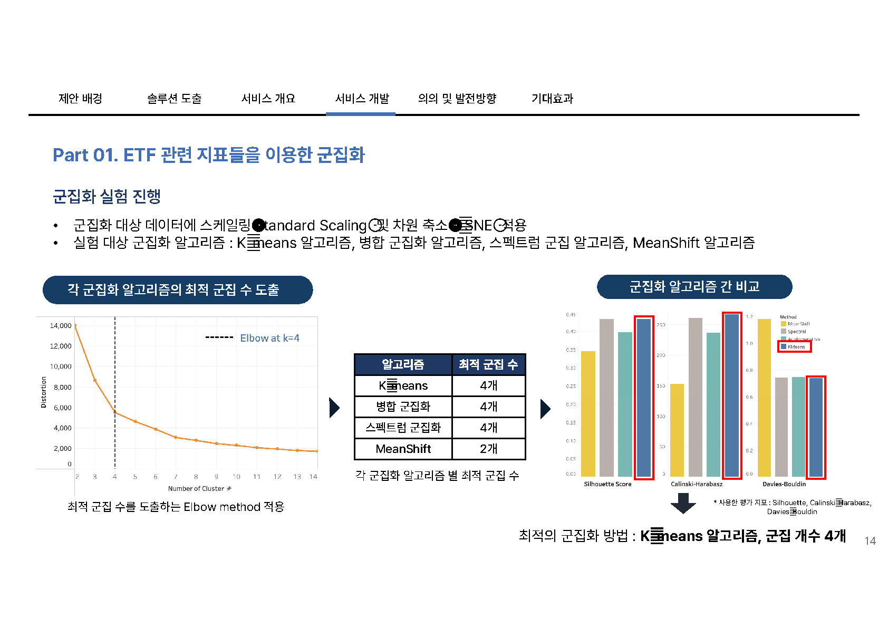

# Gen Pick - ETF 클러스터링과 생성형 AI 요약

<p align="center">2024 NH투자증권 빅데이터 경진대회 · 금융 데이터 분석 · ETF 클러스터링 · 생성형 AI</p>

> ETF 지표로 군집을 나누고, 생성형 AI로 보유 종목을 요약하며, 수익률 회귀 모델의 SHAP 값으로 기업 설명 키워드를 해석한 프로젝트다.

[](requirements.txt)
[](src/clustering_pipeline.py)
[](docs/methodology.md)
[](docs/portfolio-summary.md)

## 개요

Gen Pick은 2024 NH투자증권 빅데이터 경진대회에서 진행한 ETF 추천/설명 프로젝트다. ETF의 수익, 위험, 배당, 보유 비중, 고객 보유 패턴 지표를 바탕으로 ETF를 군집화하고, 각 군집을 대표하는 ETF와 주요 보유 종목을 설명 가능한 형태로 정리했다.

이 저장소는 금융 데이터 분석 과정과 결과를 검토할 수 있도록 정리한 공개 포트폴리오다. 수익률 회귀는 기업 설명 키워드의 기여를 분석하는 데 사용했으며, 그 결과를 투자 조언이나 검증된 미래 수익 예측으로 해석하지 않는다.

## 문제 정의

ETF는 수익률만으로 설명하기 어렵다. 추적오차, 변동성, 샤프지수, 배당 성향, 보유 종목 집중도, 고객 보유 패턴처럼 여러 지표를 함께 봐야 한다. Gen Pick은 ETF를 유사한 성격의 군집으로 나누고, 각 군집의 대표 ETF와 설명 근거를 제공하는 방식으로 리뷰어가 더 빠르게 상품을 이해하도록 설계했다.

## 담당 범위

팀 프로젝트 결과와 개인 작업을 구분해, 공개 근거로 확인 가능한 작업만 기록한다.

- ETF 보유 종목 설명을 생성형 AI로 요약하는 흐름 설계
- 보유 종목 전체를 그대로 넣지 않고 상위 보유 비중 종목 중심으로 prompt size를 제어
- 군집 일관성을 활용한 생성 요약 검토 방식 설계
- TF-IDF, XGBoost, SHAP을 활용해 보유 기업 설명 키워드와 수익 관련 신호를 연결
- NH 제한 데이터와 보안 서약/폐기 서약 자료를 제외한 공개 안전성 정리

## 개인 작업의 코드와 결과

**박민규 · AI 요약 흐름과 텍스트 설명 근거**

| 개인 작업 | 공개 구현·입력 예시 | 실제 산출물 |
| --- | --- | --- |
| 상위 보유 종목을 이용한 AI 요약 | [상위 30개 선택·요약 요청 코드](src/gen_pick_full_pipeline.py#L474) · [보유 종목 설명 입력 예시](results/sample_top_holdings_descriptions.csv) | 요약 방식과 군집 일관성 검토 기준은 [방법론](docs/methodology.md#generative-ai-etf-summary)에 정리했다 |
| TF-IDF·XGBoost·SHAP 설명 | [텍스트 벡터화·수익률 회귀·SHAP 코드](src/gen_pick_full_pipeline.py#L639) | [전체 키워드 중요도 CSV](results/keyword_importance_shap.csv) · [ABBV 개별 설명 CSV](results/sample_0_ABBV_shap_values.csv) |

<p align="center">
  
</p>

실제 발표자료의 텍스트 설명 결과다. `platform`·`segment` 등은 이 프로젝트에서 학습한 **수익률 회귀 모델의 설명 변수**다. 군집 분류의 중요도, 투자 성과 개선이나 미래 수익의 인과 근거와 구분한다. AI 요약에는 별도의 정답 요약 평가셋이 없으며, 검토 범위는 [방법론](docs/methodology.md#summary-evaluation-strategy)을 따른다.

아래 군집 비교 표와 군집 이미지는 팀 분석 결과다. 개인 작업은 위 요약 코드·SHAP 산출물로 확인할 수 있다.

## 기술적 의사결정

| 영역 | 선택 | 이유 |
| --- | --- | --- |
| 군집화 | KMeans 중심 비교 | ETF 유형을 리뷰 가능한 수의 그룹으로 나누고 대표 ETF를 선정하기 쉽다. |
| 모델 비교 | KMeans, Agglomerative, Spectral, MeanShift | 군집 구조가 특정 알고리즘에만 의존하지 않는지 비교했다. |
| 군집 설명 · 팀 분석 | XGBoost 분류 모델의 feature importance | 군집 라벨을 예측하는 보조 모델로 ETF 지표의 구분 근거를 확인했다. |
| 텍스트 설명 · 개인 작업 | TF-IDF · XGBoost 회귀 · SHAP | 평균 수익률을 대상으로 학습한 회귀 모델에서 기업 설명 키워드의 기여를 확인했다. |
| 생성형 AI | 상위 보유 종목 요약 | ETF의 주요 노출 산업과 사업 맥락을 사람이 읽기 쉽게 정리했다. |

군집 설명의 [분류 모델](src/gen_pick_full_pipeline.py#L399)과 텍스트 설명의 [회귀 모델](src/gen_pick_full_pipeline.py#L668)은 입력과 목표가 다르다.

## 파이프라인

> **군집·요약 흐름**: ETF 정량 지표 → 표준화 → 군집화 모델 비교 → 대표 ETF 선정 → 상위 보유 종목 설명 요약
>
> **텍스트 설명 흐름**: 보유 기업 설명 → TF-IDF → 평균 수익률 회귀 → SHAP 키워드·종목별 설명

## 결과 근거

| 모델 | 군집 수 | Silhouette | Calinski-Harabasz | Davies-Bouldin |
| --- | ---: | ---: | ---: | ---: |
| KMeans | 4 | 0.4343 | 266.6945 | 0.7371 |
| Agglomerative | 4 | 0.3976 | 236.8202 | 0.7463 |
| Spectral | 4 | 0.4336 | 261.3545 | 0.7418 |
| MeanShift | 2 | 0.3455 | 152.7156 | 1.1798 |

<p align="center">
  
</p>

<p align="center"><sub>실제 발표자료에서 추출한 ETF 군집화 결과</sub></p>

추가 근거는 `results/`의 파생 CSV와 `assets/presentation-slide-*.png`에서 확인할 수 있다.

## 재현 가능성

```bash
python -m venv .venv
.venv\Scripts\activate
pip install -r requirements.txt
```

전체 재현은 NH 제공 원천 데이터가 필요하므로 공개 checkout만으로는 제한된다. 공개 저장소에서는 `src/`, `results/`, `docs/`를 통해 분석 흐름과 파생 결과를 검토할 수 있다.

## 빠른 검증

비공개 데이터 없이 합성 입력으로 날짜 교집합·최근 구간 선택, 표준화, K-Means 군집 분리를 검사한다. 실제 분석 스크립트가 사용하는 [`src/clustering_core.py`](src/clustering_core.py)를 직접 실행하는 회귀 테스트다.

```bash
pip install -r requirements-test.txt
python -m unittest discover -s tests -v
```

GitHub Actions에서도 같은 테스트를 실행한다. 원본 데이터 전처리 전체, t-SNE·모델 비교, AI 요약·SHAP 및 과거 발표 수치의 재현은 검사 범위에 포함하지 않는다. 기존 전처리 스크립트의 날짜 교집합을 정렬해 최근 N일 선택이 입력 순서에 좌우되지 않도록 수정했다.

공개 포트폴리오 제출 전에는 아래 명령으로 필수 문서와 대용량 tracked 파일 여부를 확인한다.

```bash
python scripts/verify_portfolio.py
```

## 공개/비공개 경계

포함한 것:

- 분석 코드와 파생 결과 CSV
- 발표 자료에서 추출한 일부 이미지
- 방법론과 데이터 공개 경계 문서

제외한 것:

- NH 원천 데이터와 경진대회 제한 자료
- 보안 서약서, 폐기 서약서, 서명 문서
- 원본 Drive archive, `.env`, credential, private key
- 투자 수익을 보장하거나 추천하는 표현

## 한계

- 군집화는 ETF feature space의 구조를 설명할 뿐, 투자 적합성을 보장하지 않는다.
- 대표 ETF는 군집 이해를 돕는 예시이며 개인화 추천이 아니다.
- 생성형 AI 요약은 cluster consistency 중심으로 검토했으며, 별도 gold label 평가셋을 사용하지 않았다.
- SHAP keyword는 학습 모델의 설명 근거이지 미래 수익률의 인과 요인이 아니다.

## 이용 안내

이 저장소는 포트폴리오·학습 기록 열람을 위해 공개한다. 코드·문서·이미지의 재사용, 수정, 배포는 사전 문의가 필요하다.
